# First-Time Setup Guide — released v1.0.6

For people who have **already installed Direct Payment Timesheets v1.0.6**. Checked against the released source on **15/10/2026**. This guide does not describe the unreleased v1.0.7 application.

The 68 numbered pictures show a fictional practice setup. Open **Show screenshots** beneath a step to see the relevant controls. Orange outlines highlight controls; `/demo` paths belong only to the practice environment. Never copy the pictures’ dates, rates, email addresses or dummy password into your own payroll.

You can stop after any saved step and return later. Clicking a navigation button does not necessarily save what you typed. Use the named **Save** button first. Scroll down if a button is below the visible part of the window.

**Before you send anything:** use the employer, employment details and payroll dates confirmed by your local authority or payroll provider. Examples below are fictional. Never copy example dates or rates into live payroll unless they are correct for you.

## Your route through setup

**Start with section 1 below**, then follow the numbered sections in order. You do not need to finish everything in one sitting. The expandable sections contain pictures or extra detail; open them when you need help with that step.

1. Gather the details listed in section 1, then open the application, check the version and save the employer.
2. Save the payroll provider, then configure email and the Payroll Department address.
3. Obtain and import the provider's Payroll Preparation Sheet PDF. Check its dates.
4. Save each Personal Assistant (PA), then their dated hours basis and pay rate.
5. Enter shifts **or** import Hours Keeper CSV files.
6. Review and save Payroll Timesheet Preparation.
7. Generate and check the PDF.
8. Preview the email, optionally send a test, then deliberately send the real email.

There is no setup wizard: you will open each named screen yourself. Save the PA before adding their pay rate and hours basis or importing their CSV hours. Import the payroll schedule before preparing or generating a timesheet. You can save employer and email settings earlier, but a timesheet test email must wait until you have generated a PDF.

## 1. Have these details ready

Ask your local authority or payroll provider for anything you do not know:

- The employer's name, address, contact details and DP account reference.
- The **Payroll Department email address** used for timesheet submissions.
- The correct four-weekly **Payroll Preparation Sheet PDF** for your payroll year.
- Each PA's full name, employment start date, agreed hours basis and hourly pay, including any employer top-up and the dates those arrangements start.
- Any other identification the provider requires, such as date of birth and National Insurance number.
- Access to the email account you intend to send from, and its application-specific password where required.

**Success check:** you know who receives your timesheets and have the actual provider schedule. If either is missing, you can save other details, but stop before preparing or sending payroll.

## 2. First launch and dates

1. Open **Direct Payments Timesheets** from your computer's application menu.
2. Check the heading shows **DirectPaymentTimesheets v1.0.6**. The released database schema is **41**.
3. Use **Dashboard** at the bottom to return to the main workflow.
4. If you want dates shown as day/month/year, click **Settings**. Under **Calendar date display**, choose **DD/MM/YYYY — 09/09/2026**, then click **Save Application Settings**.

Next, go to section 3 and click **Employer Maintenance** at the bottom of the application window. You do not need to enter hours or send a test email yet.

Type dates such as `15/10/2026`: day first, month second, four-digit year. Use the actual date requested by each field.

**Success check:** the version is right and dates are readable. If startup reports a database or recovery problem, retain the message and ask for help. Do not delete or replace your database to try to fix it.

> **You can do this later:** themes, fonts and most folder preferences. The existing folder settings can be used for first setup. You will check the CSV and PDF folder locations when you need them.


<details>
<summary>Show screenshots 01–04: first launch, version, dates and folders</summary>

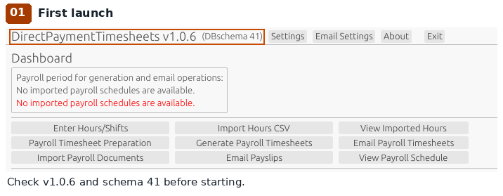

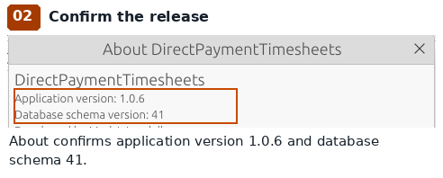

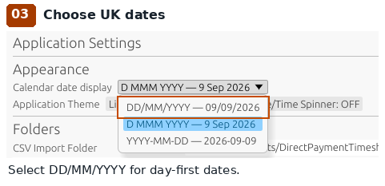

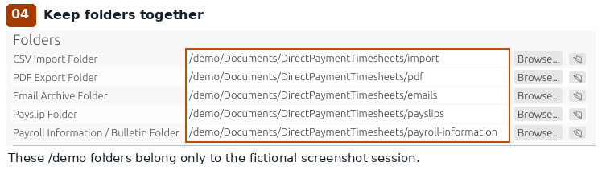

</details>

## 3. Save the employer

The employer is the person employing the PA, who may be the person receiving support.

1. Click **Employer Maintenance**.
2. If there is no employer, click **New Employer**.
3. Fill in **Employer Name**, **Email Address**, **DP Account**, **Telephone Number** and **Address** with your confirmed details.
4. Fill in **Date of Birth** and **National Insurance Number** if required by your provider. Do not invent missing information.
5. Click **Save Employer**.

Fictional examples for understanding the fields:

```text
Employer Name: Morgan Example
DP Account: SAMPLE-001
Address: 10 Example Close
         Exampletown
Email Address: morgan@example.com
```

`example.com` addresses in this guide are examples, not working mailboxes. For sending, use your actual email address, normally the account used for SMTP below.

**Success check:** the message says **Employer saved successfully.**

The form allows many details to be blank; saving alone does not establish that the record meets your provider's requirements. A non-empty, valid employer email address is needed for sending. Dates you enter must be valid dates.

> **You can do this later:** email and PDF signatures are not needed simply to save an employer. Use signatures only with the person's permission. Without configured signatures, generated PDFs have blank boxes for handwritten signing; confirm your provider's signing requirements before submission.

<details>
<summary>Optional: adding an email or PDF signature</summary>

**Edit Email Signature** adds a typed sign-off to emails. The separate **Signature** area is a physical signature image for PDFs.

1. To use an existing image, click **Select Signature...**. It accepts PNG or JPEG images (`.png`, `.jpg`, `.jpeg`, `.jfif`, `.jpe`) that the application can read. Save the employer after selecting an image.
2. To draw a signature, save the employer first, then click **Draw Signature...**. The drawing saves immediately.

Images must contain genuine PNG or JPEG data, be non-empty and no larger than 8 MiB, with width and height no greater than 4096 pixels. Renaming another file type does not convert it.

</details>


<details>
<summary>Show screenshots 05–11: employer details and optional signature</summary>

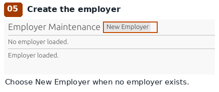

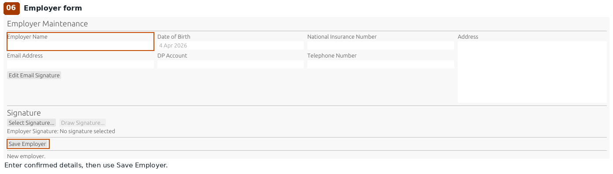

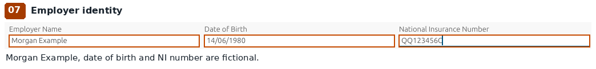

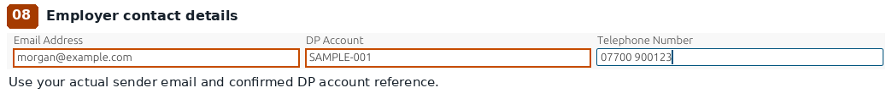

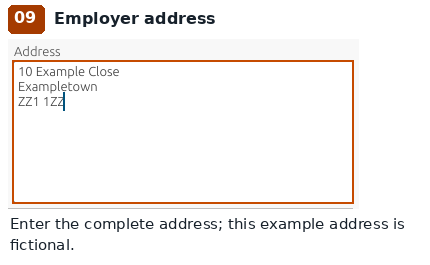

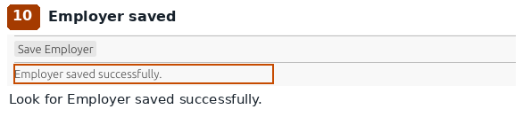

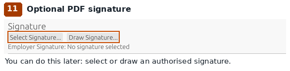

</details>

## 4. Save the payroll provider

1. Click **Payroll Settings**.
2. Under **Payroll Provider**, enter **Provider Name** and the confirmed **Provider Email**, **Provider Telephone** and **Provider Address** where available.
3. Under **Public holidays**, check the region: England and Wales, Scotland or Northern Ireland.
4. Check **Rounding Minutes** with your provider. The initial setting is **15 minutes Up**; this can affect payable hours. Do not change it by guesswork.
5. Click **Save Payroll Settings**.

**Success check:** the save completes without an error. Open **Email Settings**: the **Payroll Department** section should now offer an address field instead of **No Payroll Provider has been configured.**

**Provider Email and Payroll Department email address are separate fields.** Saving the general provider email does not set the timesheet submission address. Set that next.

> **You can do this later:** the **National / Standard Pay Rate Update** bulk action and other advanced payroll preferences. Add the first PA's agreed rate individually in step 7. Public-holiday dates do not establish entitlement or automatically remove worked hours. Do not assume overtime is calculated: v1.0.6 does not implement overtime calculation.


<details>
<summary>Show screenshots 12–15: provider, holidays, rounding and saving</summary>

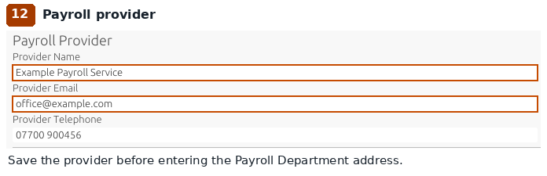

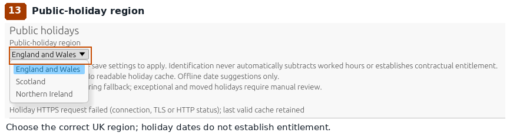

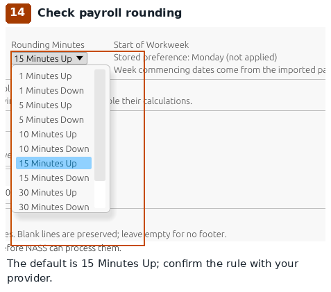

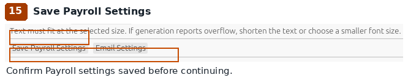

</details>

## 5. Configure email

Email settings tell the application how to send mail. They do not send anything merely because you save them.

1. Click **Email Settings**.
2. Set **Email transport** to **SMTP Server** for GMX or Gmail.
3. Select **Required STARTTLS (usually port 587)** in the security list.
4. Enter the host, port, username and password from the appropriate example below. Changing security does **not** change the port automatically.
5. Set **Payroll test email address** to a mailbox you control. Set **PA test email address** only to another mailbox you control, or leave it blank for the timesheet test.
6. Decide whether to keep **Send a CC copy of timesheet emails to the employer** selected.
7. Under **Payroll Department**, enter the verified **Payroll Department email address**. Click **Save Payroll Department Email**.
8. Click **Save Email Settings** for the SMTP settings, test addresses, copy preference and email templates.

**Success check:** **Payroll Department email address saved.** and **Email settings saved.** appear after their respective saves. These are separate save operations.

**Keep passwords private.** v1.0.6 stores the SMTP password as readable text in `config.toml` and in backups. Do not share those files or include passwords in screenshots or requests for help.


<details>
<summary>Show screenshots 16–20: SMTP transport, security, recipients and saves</summary>

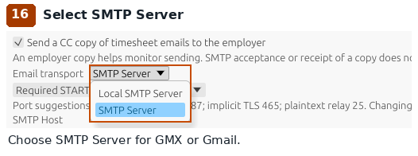

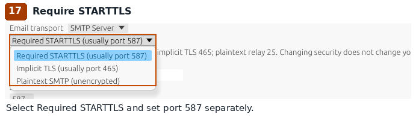

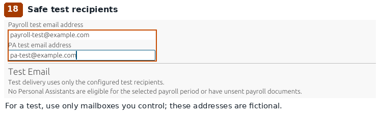

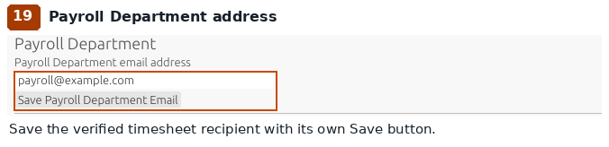

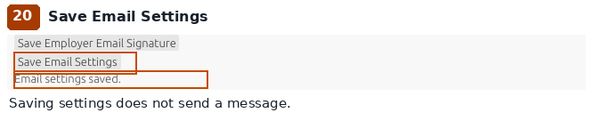

</details>

### GMX — account-tested settings

These settings and the account-access requirement were supplied from the project's **15/10/2026 account testing**; no new email was sent while preparing this guide.

```text
Email transport: SMTP Server
Security: Required STARTTLS (usually port 587)
SMTP Host: mail.gmx.com
SMTP Port: 587
SMTP Username: your full GMX email address
SMTP Password: your GMX application-specific password
```

1. Sign in to GMX in your web browser.
2. In **Email Settings**, enable **Allow POP3 and IMAP access** and save the account setting. This was required in the project's account testing, even though this application sends through SMTP.
3. Create or obtain a GMX application-specific password through your account security settings.
4. Put that password in **SMTP Password**, and save the application's email settings.

Use the complete GMX address as the username, including everything after `@`.


<details>
<summary>Show screenshots 21: GMX example with dummy credentials</summary>

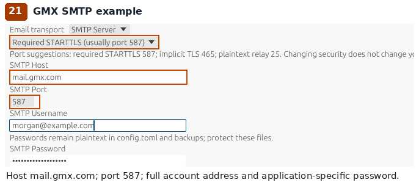

</details>

### Gmail — use a Google App Password

```text
Email transport: SMTP Server
Security: Required STARTTLS (usually port 587)
SMTP Host: smtp.gmail.com
SMTP Port: 587
SMTP Username: your full Gmail address
SMTP Password: your Google App Password
```

1. Sign in to the Google account you will send from.
2. Turn on Google **2-Step Verification** first.
3. Open the official [Google App Passwords page](https://myaccount.google.com/apppasswords).
4. Create an App Password for this application and enter it as **SMTP Password**. Use the App Password, not your ordinary Google account password.
5. Save the email settings.

Google says App Passwords require 2-Step Verification. The option may be unavailable for work or school accounts, Advanced Protection, or accounts with verification set up only for security keys. If unavailable, ask the account administrator or use a compatible account; v1.0.6 has no **Sign in with Google** flow. Changing your Google account password revokes existing App Passwords. See [Google's App Password instructions](https://support.google.com/accounts/answer/185833).


<details>
<summary>Show screenshots 22: Gmail example with dummy credentials</summary>

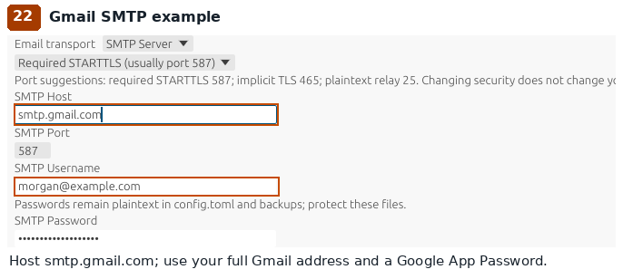

</details>

### Outlook.com, Hotmail.com and Live.com

**Password-based SMTP failed with error 535 during the project's v1.0.6 testing** for Microsoft Outlook.com, Hotmail.com and Live.com accounts. Repeatedly entering the ordinary account password is not a supported solution. Microsoft OAuth2 support is **planned for v1.0.7**; it is not available in released v1.0.6, and the plan is not a promise of availability. Use a compatible sending account or an appropriately managed relay for v1.0.6.

### Local SMTP relay — only if someone has already set it up

> **You can do this later:** most users should use their email provider settings above.

The **Local SMTP Server** transport uses **localhost, port 25, no encryption and no username or password**. It is compatible only with a relay already running on your own computer that accepts this connection and secures onward delivery. Choosing it does not install a relay or make an ordinary email account work. Ask the person managing the relay to confirm it is ready; otherwise choose **SMTP Server**. Do not select plaintext for GMX or Gmail.


<details>
<summary>Show screenshots 23: the optional local relay</summary>

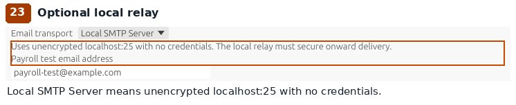

</details>

### Why you cannot test email yet

**Test Timesheet Email** and **Test Payslip Email** are genuine v1.0.6 controls, but not simple connection-test buttons. They appear only when suitable PAs are available. The timesheet test also requires the employer's email, the selected imported period and a valid generated timesheet PDF. Return to [step 11](#11-preview-and-optionally-test-the-email) after generating the first PDF.

> **You can do this later:** typed **Employer Email Signature**, subject changes and email body changes. Keep the defaults initially.

<details>
<summary>Optional: saving your email sign-off (screenshot 24)</summary>

The email signature has its own **Save Employer Email Signature** button. Do not confuse it with a drawn PDF signature.

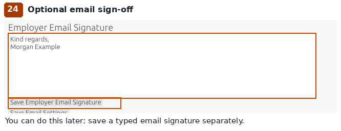

</details>

## 6. Obtain, save and import the payroll schedule

**Never guess payroll dates, calculate a replacement calendar yourself, or rename another file to make it look like a schedule.** The application needs the provider's actual schedule.

### Get the right document onto this computer

1. Ask your local authority or payroll provider for the **four-weekly Payroll Preparation Sheet PDF** for your payroll year. Explain that the application expects 13 periods with first-week, latest-posting and pay dates.
2. If it arrives by email, open the attachment's download or save option. If it is on the provider's website, use its download link.
3. Save the original PDF in a folder you can find, for example a folder called `Payroll schedules` inside **Documents**. Downloads may initially go to **Downloads**.
4. In your computer's file manager — **File Explorer** on Windows, **Finder** on Mac, or **Files** on Linux — open that folder. Check you can see the saved `.pdf` file.
5. Open the PDF. Confirm the provider, payroll year and schedule are right. Keep the original file unchanged.

### Import the saved PDF

1. Return to **Dashboard**.
2. Click **Import Payroll Documents**.
3. In the file window, open the folder where you saved the PDF. Select the actual PDF and confirm the file choice.
4. Read the import result. Look for **13 schedule entries imported**, and check there is no Prep Sheet parsing failure. A file being stored does not by itself mean its schedule was imported.
5. Click **View Payroll Schedule**. Select the relevant payroll year.
6. Compare all 13 rows with the original PDF: first week commencing, latest posting date and pay date. Pay particular attention to the period for your first timesheet.
7. Check the Dashboard's payroll-period selector and choose the intended period before entering payroll preparation. Historical and future periods can be selected deliberately; they are not necessarily the current period.

**Success check:** the correct year and 13 matching periods are visible. You know the submission deadline and pay date for your intended period. Stop and ask the provider if the dates differ.

For first setup, use the original provider PDF with readable text. Word `.docx` import is **not implemented**, even though it appears in the file chooser. Excel, schedule CSV files and scanned image-only PDFs are not supported schedule imports. Ask the provider for the readable PDF rather than converting or renaming a file yourself.

<details>
<summary>Extra detail: supported schedule files and import checks</summary>

| File | Schedule import support |
| --- | --- |
| Provider Payroll Preparation Sheet PDF with readable text in the expected layout | Supported through **Import Payroll Documents**. This is the simplest first-time route. |
| ZIP containing a recognised preparation-sheet PDF | Supported through the same button. For first setup, prefer the individual PDF; a mixed ZIP with ordinary payslips can need an already imported period. |
| Word `.docx` | Listed in the file chooser, but Word preparation-sheet import is **not implemented**. Ask for the supported PDF. |
| Excel, schedule CSV, image or scanned image-only PDF | No supported schedule-import procedure in v1.0.6. Hours Keeper CSV is a different import. Ask for the original readable PDF. |

The PDF parser checks for `PAYROLL PREPARATION SHEET`, `PAY DAY EVERY FOUR (4) WEEKS` and a year such as `2026/27`. It expects exactly **13 rows**, each with three readable dates. Period starts must increase by exactly **28 days**; posting and pay dates cannot precede that period's start. A valid-looking PDF from a different provider can still have an incompatible layout.

</details>

An unchanged schedule can be re-imported. Import replaces that payroll year's schedule together, preserves other years, and rejects invalid input without replacing the existing schedule. Changes affecting prepared payroll history can be refused. Do not try to bypass that protection; ask for help with the exact message.


<details>
<summary>Show screenshots 25–31: schedule selection, import and verification</summary>

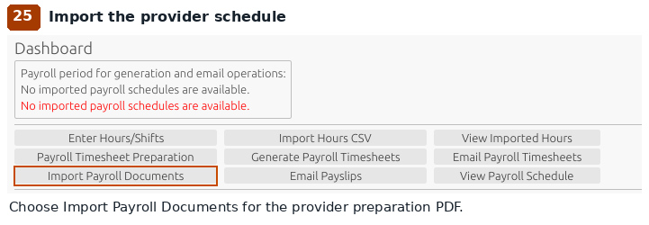

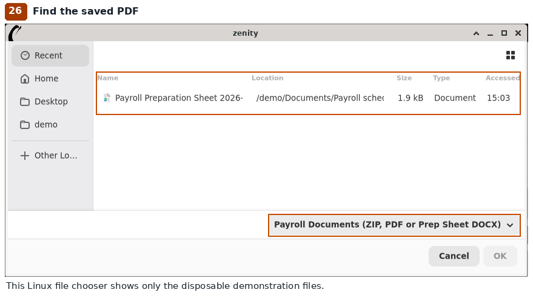

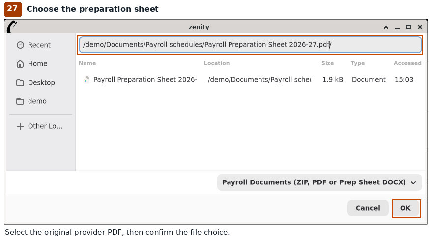

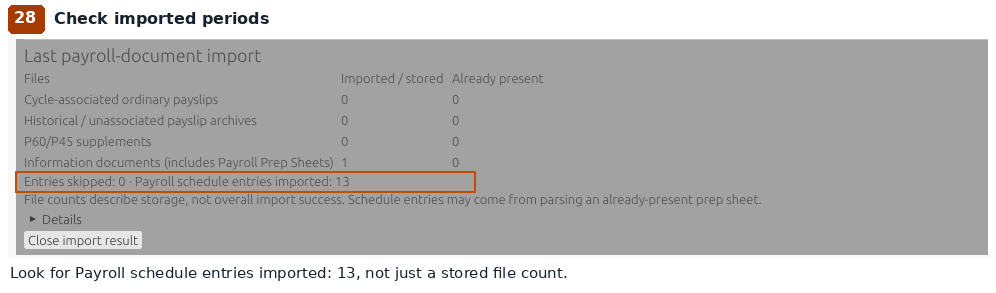

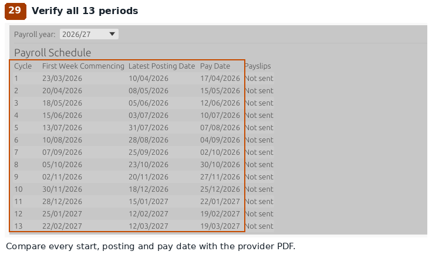

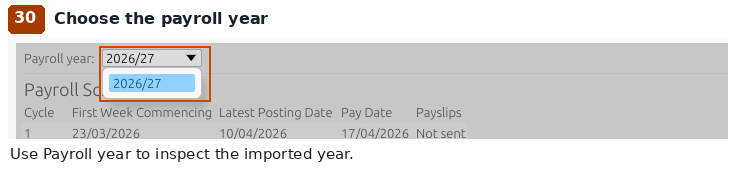

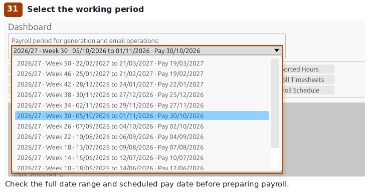

</details>

## 7. Add the Personal Assistant and employment details

1. Click **Personal Assistant Maintenance**, then **New Personal Assistant**.
2. Enter **Given name(s)** and **Surname** exactly as used for that PA's Hours Keeper records. For a fictional example, use `Alex` and `Example`.
3. Enter confirmed **DoB**, **NI No.**, **Email**, **Phone**, **Address** and **Postcode** as needed by your provider. A PA email is needed if you want their email copy; do not put an example address into live sending settings.
4. Keep **Active** selected for a current employee. Enter their actual **Start date**. Leave **Leaving date** blank if they have not left.
5. Click **Save Personal Assistant**. Select the saved PA under **Existing Assistants** if necessary.
6. Under **Contracted Weekly Hours**, enter **Effective from** and choose **Hours basis**: **Contracted** for agreed weekly hours, or **Variable** for variable hours. For Contracted, enter the agreed **Weekly hours**, such as `20` if that is correct for this employment. Click **Save Hours Basis**.
7. Under **Pay Rates**, enter **Effective date**, **Base hourly rate** and **Employer top-up rate**. Use numbers without a pound sign, for example `13.50` and `0.00`. Click **Save Pay Rate**.
8. Check both saved histories. The dates must cover the work being included in your first timesheet, including earlier work if applicable. Use the real agreed effective dates, not automatically today's date.

**Success check:** the PA appears in **Existing Assistants**, with saved hours-basis and pay-rate rows. The messages include **Contracted hours saved.** and **Pay rate saved.** after those saves. Repeat for each PA.

**Check the numbers yourself:** the rate form can turn unparseable rate text into `0.0`; a successful save does not prove the amount is correct. Do not rely on it to check the agreed or legally applicable rate. Effective dates must be valid; Contracted hours require a non-empty weekly-hours value, while Variable does not require a weekly total. Blank optional personal dates are allowed; entered dates must be valid, and a leaving date cannot precede the start date.

The application does not require every contact field to be filled before saving. Your provider may require more information than the form enforces. Complete the confirmed employment and pay details before submitting payroll.

> **You can do this later:** PA signature, **Enable mileage** if no mileage is being claimed, and read-only annual-leave guidance. Signatures follow the employer image/drawing options above. Do not mark an employed PA Inactive as a setup shortcut: changing Active to Inactive also files their managed payroll documents into archive folders.


<details>
<summary>Show screenshots 32–42: PA, employment details, hours basis and pay rate</summary>

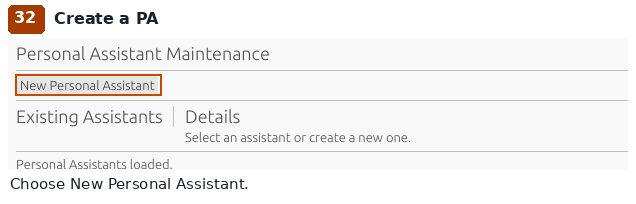

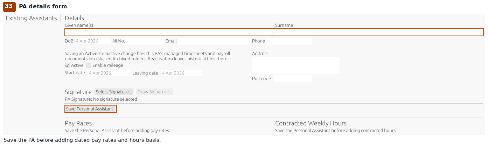

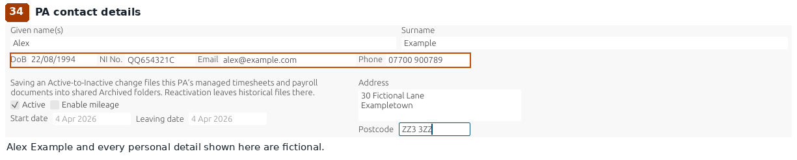

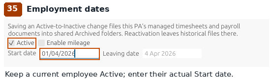

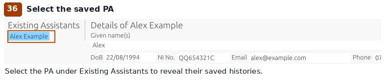

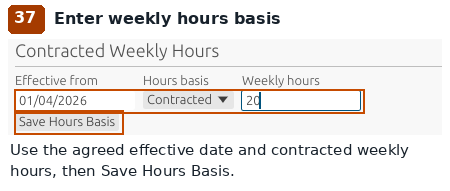

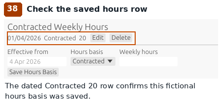

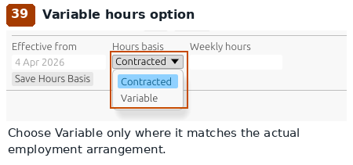

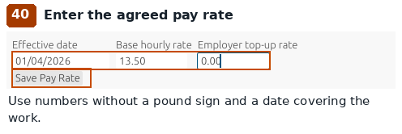

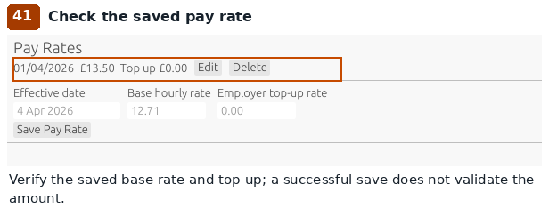

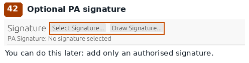

</details>

## 8. Put hours into the application

Choose the method that matches how the hours were recorded. Do not enter and import the same shift twice.

### Option A: enter shifts directly

1. On **Dashboard**, click **Enter Hours/Shifts** and select the correct PA.
2. For an already completed shift, click **Clock in at…**. Choose the actual UK date and 24-hour start time, then **Use this time**.
3. Enter any **Break minutes** and optional notes. Use **Save Notes** when saving those details for the running shift.
4. Click **Clock out at…**, choose the actual end date and time, then **Use this time**. The end must be after the start; select the following date for an overnight shift where appropriate.
5. Check **Shift history** shows the intended start, finish, break and worked time.

For work happening now, **Clock in now** and **Clock out now** use the current time. Do not use them to represent a past shift. Payroll rounding is applied later; the shift records actual time.

**Success check:** the shift is completed, with no unintended running clock-in. Correct mistakes through the shift-history controls before payroll preparation.


<details>
<summary>Show screenshots 43–48: exact shift entry, breaks and completion</summary>

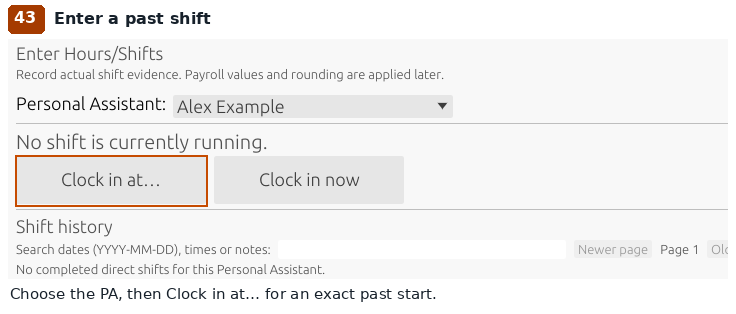

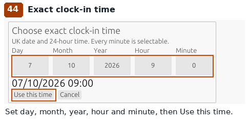

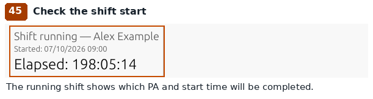

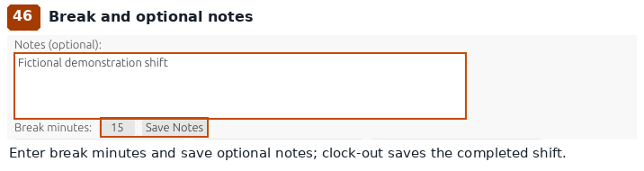

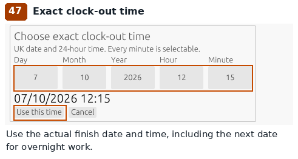

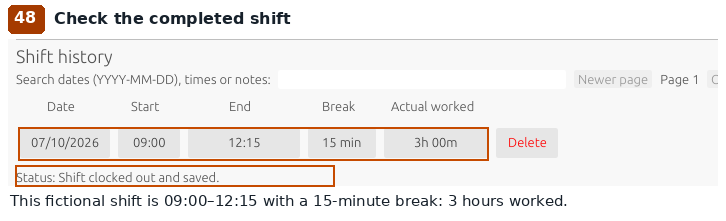

</details>

### Option B: import Hours Keeper CSV

1. In Hours Keeper, export the relevant recorded hours as **CSV**. Transfer or download that file to this computer. Keep the original export.
2. Click **Settings** and find **CSV Import Folder**. Note the full folder location. Use **Browse...** if you need to choose a folder you can find, then **Save Application Settings**.
3. In your file manager, copy the `.csv` export into that exact folder. Keep only the CSV files you intend to import there: the button scans the folder, rather than opening a file chooser for a single CSV.
4. Return to **Dashboard** and click **Import Hours CSV**.
5. Read **Import Summary**. Check **Files succeeded**, **Rows imported**, **Rows skipped**, **Files refused**, **Files failed** and any error messages.
6. Click **View Imported Hours**. Check the PA, dates, breaks and worked hours against the export. Resolve any duplicate or overlap review before preparing payroll.

**Success check:** all expected shifts are associated with the right maintained PA, and no unexplained failures or skipped rows remain. Duplicate detection may correctly skip already imported content; do not assume skipped rows are new hours.

The PA name must match exactly one maintained PA. **Worked Hours is imported as supplied**, not recalculated from start, end and break. Check it carefully. CSV rates and amounts are retained as source information; the saved PA pay-rate history is authoritative for payroll. The application keeps a timestamped archive of imported source files.

<details>
<summary>Extra detail: CSV format, sample file and validation rules</summary>

The supported export is UTF-8 text with a non-empty first description line, followed by eight column headings. The standard headings are **Client Name, Start Time, End Time, Break Time, Worked Hours, Rate/h, Amount, Note**. Short aliases **PA, Start, End, Break, Worked, Rate, Amount, Note** are also accepted. All eight columns are required; Note may be blank.

This copyable fictional example illustrates the format, not hours to submit:

```csv
Hours Keeper sample export
Client Name,Start Time,End Time,Break Time,Worked Hours,Rate/h,Amount,Note
Alex Example,15/10/2026 at 09:00,15/10/2026 at 12:00,0h 00m,3h 00m,13.50,40.50,Sample only
```

The importer accepts UK dates with `at` and a 24-hour time, with optional seconds; English month-name timestamps and ISO year-month-day timestamps with `at` are also supported. Break and worked durations must use `3h 00m` style: non-negative hours and minutes from 0 to 59. End time must be later than start time. Money must be a non-negative finite number, optionally prefixed with `£`.

</details>


<details>
<summary>Show screenshots 49–54: CSV folder, import summary and source review</summary>

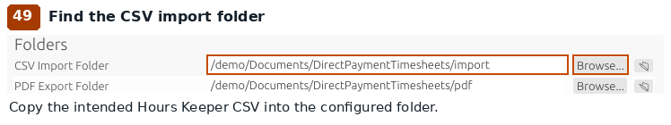

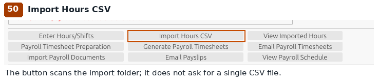


</details>

## 9. Review and save payroll preparation

1. Return to **Dashboard**. Check the selected payroll period against the provider schedule again.
2. Click **Payroll Timesheet Preparation**.
3. Select the PA and activate their record if the screen asks you to activate it for editing.
4. Check all four **W/c** (week commencing) rows and **Worked** totals against the recorded shifts. Payroll rounding can make payable totals differ from the original minutes.
5. Add only confirmed **Annual Leave**, **Sick / SSP**, **Public Holiday** and **Travel Miles** information that applies. Use the relevant dated-entry controls. Payroll calculates SSP; do not guess a payment or entitlement.
6. Check **Previous cycle hours** and any unresolved review actions. Do not invent earlier hours to make totals match.
7. Add **Notes for Payroll Department** if needed; the limit is **256 characters**.
8. Click the PA's **Save [name]** button, for example **Save Alex Example**. Repeat for other PAs.

**Success check:** the preparation saves without errors, the four weeks match your period, and no unresolved payroll actions remain. The **W/c** rows are week-start dates; use the full date range in the period selector to check the period end. If an unsaved-changes prompt appears, choose **Save changes** to keep your work.

> **You can do this later:** notes or claims that do not apply can stay blank. **Actual in-lieu hours awarded by Payroll** is for a figure returned by Payroll later; leave it blank until Payroll confirms it. Submitted records and records with indeterminate delivery are read-only; do not bypass those protections.


<details>
<summary>Show screenshots 55–59: weekly preparation, optional sickness, notes and save</summary>


</details>

## 10. Generate and inspect your first PDF

1. On **Dashboard**, check the period, then click **Generate Payroll Timesheets**.
2. In **Generate payroll timesheets — select PAs**, select only the PAs you intend to generate. Review the period and public-holiday information.
3. Click **Generate selected PAs**.
4. If **Signature unavailable — choose how to continue** appears, read the reason. Use **Draw replacement...** only with permission, **Continue unsigned** if appropriate, or **Cancel generation**. Unsigned PDFs need the provider's agreed signing process.
5. Read the production report for each selected PA. A failed or skipped PA is not a successfully generated timesheet.
6. To find the file, click **Settings** and note **PDF Export Folder**. Open that folder in your file manager and locate the PDF for the PA and period. Open it in your PDF reader.
7. Check employer and PA identity, period, all four weekly totals, pay rates, leave, sickness, mileage, notes and signatures as applicable. Compare against your records and the schedule.

**Success check:** a readable PDF exists for the right PA and period, with correct information. Generating a PDF does not email it.

If you find a mistake, correct the saved preparation or source details and generate again **before sending**. Changed represented data can make an earlier generated PDF stale; do not send an old copy from a folder as a workaround.


<details>
<summary>Show screenshots 60–62: PDF generation and genuine generated output</summary>


</details>

## 11. Preview and optionally test the email

1. Click **Email Settings** and select the PA under **Email Preview**.
2. Click **Preview Timesheet Email**. Check **From**, **To**, **CC**, **BCC**, **Subject**, **Attachment** and **Body**.
3. Confirm the Payroll Department is the intended **To** recipient. The employer gets a CC if enabled; a supplied PA email is used as BCC. Correct saved addresses if needed, then preview again.

**Preview never sends an email or updates sent status.** It does not prove the SMTP password works. A preview error may mean a required employer, provider, period or attachment is missing.

> **You can do this later:** the optional test below. It is a real email transmission, separate from the preview and from a real payroll submission.

1. Check **Payroll test email address** is a mailbox you control. The optional **PA test email address** must also be safe and under your control. Save the email settings.
2. Under **Test Email**, choose the PA with a valid generated PDF for the selected period.
3. Click **Test Timesheet Email** only when you intend to send that attachment to those test addresses.
4. Look for **Test timesheet email sent.**, then check the receiving mailbox and its spam folder.

The timesheet test uses the Payroll test address as **To**, optional PA test address as **BCC**, and **no employer CC**. It prefixes subject and body with **TEST:**. **It attaches the actual generated timesheet, which may contain personal information.** It does not create a harmless sample automatically. Use fictional data for a practice installation, or only appropriately authorised recipients for a real attachment. Test sending does not mark the real payroll submission as sent.

**Test Payslip Email** needs existing eligible unsent payroll documents and the **PA test email address**. It is not needed to set up your first outgoing timesheet. It uses the test recipient, rather than the real PA, and does not mark those documents sent. Do not import payslips merely to obtain an SMTP test button.


<details>
<summary>Show screenshots 63–64: safe preview and optional test controls</summary>


</details>

## 12. Send the real payroll email safely

1. Confirm the reviewed PDF is final, any required signing is complete, and you are ready to submit by the provider's deadline.
2. On **Dashboard**, confirm the period and click **Email Payroll Timesheets**.
3. In **Email payroll timesheets — select PAs**, check the selected PAs. Current unsent PDFs are selected by default; previously sent versions can be listed for a deliberate resend. Avoid selecting a resend for a first submission.
4. Click **Continue to email notes**. Choose **No Additional Note**, or **Add Additional Note**, enter any needed note for each selected PA and click **Continue**.
5. In **Confirm email batch**, check the period, PA list, first-send/resend counts, document details and **To / CC / BCC** addresses. Cancel if anything is wrong.
6. Click **Send** once, only when you intend to send the real payroll email.
7. Read the per-PA production result and **Timesheet Email Status**. Keep the PDF and delivery evidence. Follow your provider's procedure for confirming receipt.

**Success check:** the intended submission is recorded as **Accepted by SMTP**, without failures or unresolved uncertainty. This means the mail server accepted it; it does **not** prove Payroll received it in their inbox. Receipt of your employer copy proves only receipt of that copy.

If the result is uncertain or the application was interrupted during sending, **do not click Send again or send the PDF manually** until you have checked the evidence with Payroll or your mail administrator. An error can happen after acceptance. v1.0.6 blocks uncertain retries pending a documented delivery review. An intentional resend needs explicit acknowledgement and may cause duplicate payroll processing.

> **You can do this later:** returned payslip import and **Email Payslips** belong to a later stage, after Payroll processes your submission. They are not needed to generate or send the first timesheet.


<details>
<summary>Show screenshots 65–68: recipient selection, confirmation and the unsent demo</summary>


</details>

## Troubleshooting

| What you see | What to do |
| --- | --- |
| No Payroll Provider has been configured | Save the provider in **Payroll Settings**, then return to **Email Settings** to save the separate Payroll Department address. |
| No imported payroll schedules / no current period | Import the individual provider preparation PDF. Check the year and coverage. Select a known period deliberately if needed; never guess missing dates. |
| Old “No imported payroll schedules are available” warning remains after a successful first import | If the schedule table contains the 13 verified rows, close and reopen the application, then recheck the intended period. The initial warning can remain stale in v1.0.6. |
| PDF stored, but schedule import failed | Read the Prep Sheet parsing failure. Ask for a readable original PDF in the supported format. Stored information files are not proof of imported schedule entries. |
| Expected 13 entries / missing four-weekly information | The document does not match the supported schedule layout. Ask the provider for the correct preparation sheet; do not edit dates to force acceptance. |
| Word importing is not implemented | Obtain the supported PDF. A `.docx` entry in the file chooser does not mean Word parsing works. |
| CSV finds no files | Check **CSV Import Folder** is the folder containing the actual `.csv` file and that you saved folder changes. |
| CSV refused: PA missing or ambiguous | Compare the export name with the saved given name(s) and surname. Ensure there is exactly one matching PA. Do not add duplicate PA records to bypass the error. |
| CSV timestamp, header or duration error | Keep the original export and read the reported row. Compare its structure with step 8. Do not rename a spreadsheet to `.csv`; obtain the supported export. |
| Imported totals differ | Check Worked Hours in the export, duplicate/overlap reviews, period selection and rounding. Worked Hours is not recalculated from the clock times. |
| Pay rate is missing, zero or unexpected | Check the saved PA rate history, numeric values and effective dates covering the work. CSV rates do not replace maintained rates. |
| Test controls absent, or no attachment found | Finish saving an eligible PA, importing/selecting the period, saving preparation and generating the PDF. There is no standalone empty-install SMTP test. |
| Authentication error 535 | Recheck full email username and application-specific password. For GMX check **Allow POP3 and IMAP access**. For Gmail check 2-Step Verification and App Password availability. Microsoft password-based SMTP failed in project testing; OAuth2 is absent from v1.0.6. |
| SMTP connection or TLS error | Check internet access, exact host, port **587** and **Required STARTTLS** for GMX/Gmail. Do not disable encryption as a workaround. |
| Local SMTP connection refused | A local relay must already be running on localhost:25. Use your provider's SMTP configuration if no relay has been arranged. |
| Stale PDF / changed data | Save the correct preparation, generate again, inspect the new PDF and preview again. |
| Submitted or indeterminate record is read-only | Retain the message and ask for help. Do not delete records, alter the database or resend blindly. |

When asking for help, provide the application version, screen, exact message and the step you reached. Remove passwords, names, National Insurance numbers, dates of birth and payroll attachments from anything shared publicly.

## Keep a safe copy

1. In **Settings**, click **Create Backup** when you are ready to keep a recovery copy.
2. Protect that backup: it contains database and configuration information, including the SMTP password.
3. Separately protect your PDFs, original exports, provider documents and signatures. The application's database/configuration backup does **not** copy those external files.

## Screenshot and verification notes

**68 genuine screenshots are included:** 65 views of the released application, two views of its native Linux file chooser, and one view of its genuinely generated PDF in a separate PDF reader. They were captured from an unchanged source build of tag **v1.0.6**, commit `e157cbd754020e250806b07d40d0fd1a8e755938`, on **15/10/2026**. Only crops, orange outlines and numbered captions outside the captured UI were added. No UI controls or messages were invented, and no displayed values were retouched.

All employer, PA, contact, employment and work records shown are fictional. The practice schedule was created solely to exercise the supported import format; obtain your own schedule from your provider. The practice environment had no access to production home directories or an external network. Every configured business folder, database, configuration, cache, log and generated file was contained in disposable storage. See the [capture and isolation record](images/first-time-setup/README.md).

The Linux walkthrough covered first setup, schedule import, both hours-entry methods, saved preparation, PDF generation, preview and final email confirmation. **No Test Email or Send button was used.** The demonstration was cancelled and the current PDF remained unsent. Successful SMTP authentication, successful test-mail delivery, real payroll submission, other operating systems and optional signature drawing were not tested in this capture session. The GMX access requirement and Microsoft 535 results earlier in this guide remain the project account-testing observations supplied for **15/10/2026**.

For maintainers, the released source evidence is in [navigation, email and Dashboard UI](https://github.com/arnieSkyNet/DirectPaymentTimesheets/blob/v1.0.6/src/gui.rs), [employer form](https://github.com/arnieSkyNet/DirectPaymentTimesheets/blob/v1.0.6/src/employer_screen.rs), [PA form](https://github.com/arnieSkyNet/DirectPaymentTimesheets/blob/v1.0.6/src/personal_assistant_screen.rs), [schedule parser and import tests](https://github.com/arnieSkyNet/DirectPaymentTimesheets/blob/v1.0.6/src/payroll_prep_sheet_import_service.rs), [CSV parser](https://github.com/arnieSkyNet/DirectPaymentTimesheets/blob/v1.0.6/src/csv_import.rs), [shift entry](https://github.com/arnieSkyNet/DirectPaymentTimesheets/blob/v1.0.6/src/enter_hours_screen.rs), [preparation](https://github.com/arnieSkyNet/DirectPaymentTimesheets/blob/v1.0.6/src/payroll_timesheet_screen.rs), [generation and delivery selection](https://github.com/arnieSkyNet/DirectPaymentTimesheets/blob/v1.0.6/src/payroll_production_workflow.rs) and [SMTP/test composition](https://github.com/arnieSkyNet/DirectPaymentTimesheets/blob/v1.0.6/src/email_service.rs).
